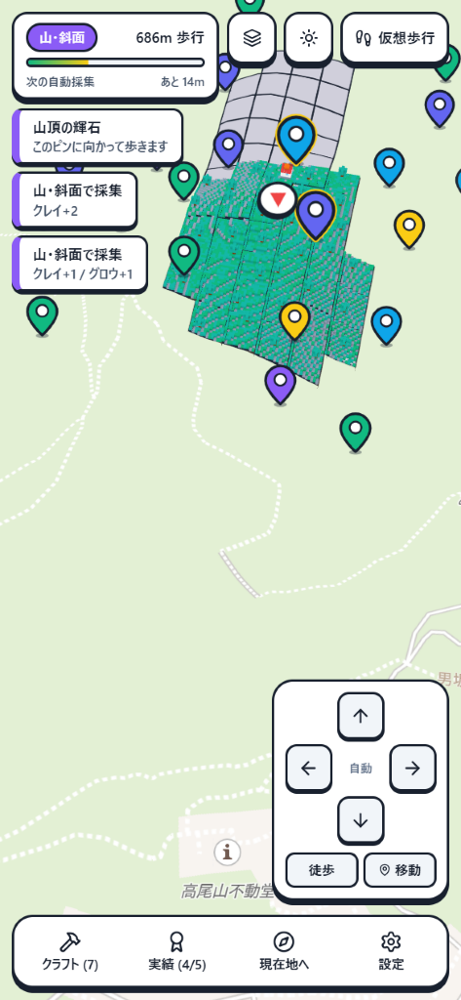
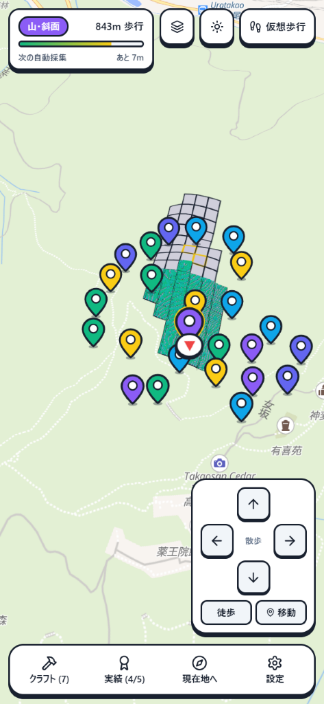
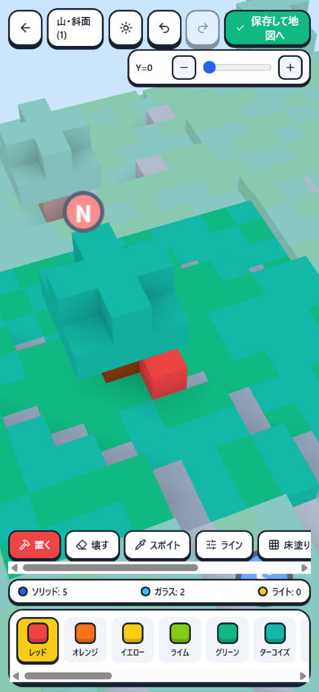

# アルクバコ（Arukubako）

**歩いた場所が世界になる — 現実の地図と標高を活かして建築する位置情報×ボクセル建築サンドボックスゲーム（Web / Android Capacitor）**

歩いて建材を集め、現実世界の区画を解放し、その土地のバイオームや実標高の傾斜を反映した 3D 地形の上に自分だけの建築をつくれます。

---

## ゲーム画面の例

| メインマップ（探索・3D地形＆レアピン） | 広域マップ（ズームアウト表示） | 3D建築エディタ（周囲8方位＆19色） |
| :---: | :---: | :---: |
|  |  |  |

<sub>高尾山の傾斜を反映した 3D ボクセル区画、採集範囲（50m 圏内）で黄金枠強調される GPU レアスポットピン、および周囲 8 方位の区画と 19 色トイブロックパレットを備えた `12×48×12` 建築エディタの画面例です。</sub>

---

## 主な特徴

- **MapLibre 3D 地形 × 接地ボクセル区画**
  - AWS Terrarium 標高タイルを用いた 3D 地形メッシュと同期し、山の急斜面や街区に合わせたボクセル地形＋基礎スカートを現実の地図上に表示します。
  - ズーム縮尺に応じた 3 段階 LOD（3D ボクセル表示／2D バイオームグリッド／クラスター集計）に対応しています。
- **現実連動の探索・採集と GPU レアスポットピン**
  - 実際の歩行距離（またはテスト用仮想歩行モード）に応じて 25m ごとに自動採集・周囲 40m 圏内の区画アンロックが発生します。
  - 地図の拡大縮小でも位置がズレない MapLibre ネイティブ GPU シンボルレイヤーのレア採集スポット（50m 圏内で金色ハイライト）をタップして希少素材を集められます。
- **12 × 48 × 12 3D 建築エディタ（周囲 8 方位表示＆設計図）**
  - 前後左右斜めの周囲 8 区画の傾斜と建築を参照しながら、高さ 48 ブロックまで自由に建築できます。
  - ビビッドなソリッド 16 色＋ガラス＋ライト 2 色の 19 種類ブロック、高速 3D DDA レイキャスト、地形復元機能、クラフト＆設計図スタンプを備えています。
- **オフライン永続化＆仮想歩行モード**
  - IndexedDB により区画・建築・在庫・マイルストーンをローカル保存します。
  - PC や室内でもすぐ検証できるよう、仮想歩行十字キーと主要スポットワープ（高尾山・代々木公園・東京駅など）を標準搭載しています。

---

## 技術スタック

- **フロントエンド**: React 19 / TypeScript / Vite / Zustand / Lucide React
- **地図・3D**: MapLibre GL JS 5 / Three.js
- **モバイルアプリ化**: Capacitor 8 Android (`@capacitor/geolocation`)
- **テスト**: Vitest + jsdom

---

## セットアップとコマンド

### 1. 開発サーバーの起動（Web / ブラウザ検証）

```bash
npm install
npm run dev
```

起動後、ブラウザで `http://127.0.0.1:5173`（Chrome DevTools 等のモバイル縦画面 `390×844` 推奨）を開いてください。

### 2. テスト・型チェック・本番ビルド

```bash
npm run typecheck
npm run test
npm run build
```

### 3. Android プロジェクト同期・ビルド

```bash
npm run cap:sync
npx cap open android
```

---

## ドキュメント

- ゲーム仕様書: [docs/SPEC.md](docs/SPEC.md)
- 操作手順書・評価チェックリスト: [docs/MANUAL.md](docs/MANUAL.md)

---

## データクレジット・ライセンス

- **地図データ**: © OpenStreetMap contributors / OpenFreeMap
- **標高タイル**: Mapzen Terrain Tiles / Registry of Open Data on AWS
- **ライセンス**: [MIT License](LICENSE)
